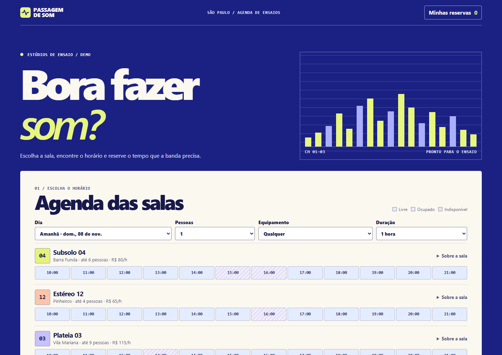

# Passagem de Som

Uma agenda de ensaios com salas fictícias, filtros e reservas gravadas de verdade. A régua de horários mostra o que cabe no intervalo escolhido. A reserva pode ser consultada ou cancelada no mesmo navegador.



## Como rodar

Node.js 24 e npm.

```sh
npm ci
npm run build
npm start
```

Abra http://127.0.0.1:4173. O banco local fica em `.local/passagem-de-som.sqlite`.

```sh
npm test
npx playwright install chromium
npm run test:browser
```

## A reserva concorrente

O Worker executa um único INSERT condicional no SQLite/D1. Como a checagem de interseção faz parte da gravação, duas requisições para o mesmo intervalo não conseguem reservar a mesma sala. A requisição que perde recebe HTTP 409 e a interface atualiza a agenda. Horários contíguos são aceitos. O mesmo identificador e conteúdo podem ser reenviados sem duplicação enquanto a reserva existir.

O [Airbnb](https://www.airbnb.com/) orientou a combinação de data, espaço e capacidade. A agenda, marca e composição foram desenhadas para o fluxo de ensaio. A demo tem datas para até 14 dias, horários compartilhados, dados fictícios e preços simulados. O cancelamento usa o comprovante aleatório guardado no navegador. Limpar os dados do navegador remove esse comprovante.

[Contrato da API](docs/solution-contract.md)
